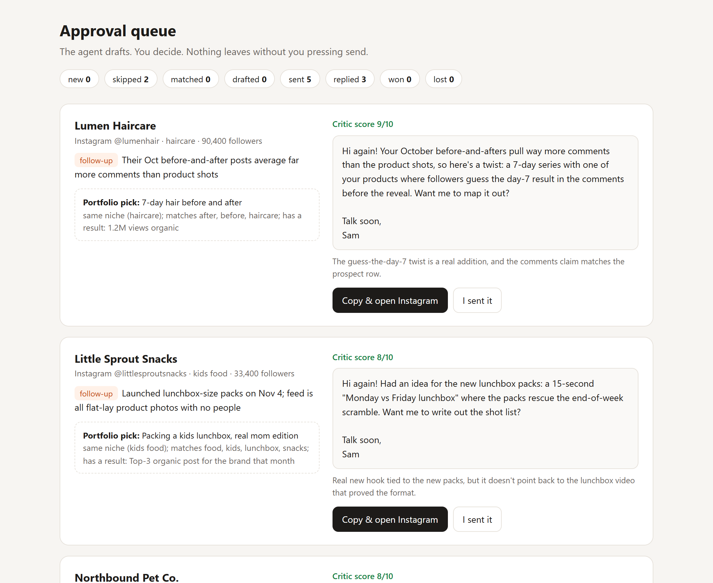
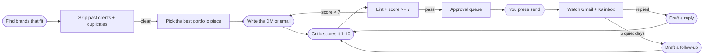

# creator-lead-agent

An AI outreach assistant for UGC creators, freelancers and anyone who lives on inbound leads. It finds brands that are a real fit, makes sure you never cold-pitch a past client or the same brand twice, picks the one portfolio piece most likely to land, drafts a short message in your voice, has a second AI critique it, and lines it all up for you to approve. **You press send.** Then it watches Gmail and your Instagram inbox for replies and drafts what comes next.

It runs on [Claude Code](https://claude.com/claude-code). Every "AI" step is a plain-English file you can read and edit.



## How it works



Rounded = Claude. Square = plain code. Hexagon = you.

| Piece | File | What it is |
|---|---|---|
| Instructions | [`CLAUDE.md`](CLAUDE.md) | The job description and the rules that never bend |
| Skills | [`.claude/skills/`](.claude/skills) | How to find prospects, pick a piece, write a DM, check replies |
| Subagent | [`.claude/agents/dm-critic.md`](.claude/agents/dm-critic.md) | A strict "brand marketing lead" that scores every draft |
| Tools (MCP) | [`agent/mcp_server.py`](agent/mcp_server.py), [`.mcp.json`](.mcp.json) | The tracker, exposed to Claude. There is deliberately no send tool |
| Guardrails | [`.claude/settings.json`](.claude/settings.json), [`.claude/hooks/`](.claude/hooks) | Permissions, a hook that blocks any send, an audit log |
| The loop | [`.claude/commands/daily-run.md`](.claude/commands/daily-run.md) | One command runs the whole graph |
| Schedule | [`scripts/`](scripts) | Windows Task Scheduler or cron |
| Approval queue | [`agent/queue_app.py`](agent/queue_app.py) | Local page where you review, copy and send |

## Quick start (10 minutes, demo data)

```bash
git clone https://github.com/christina-cartagena/creator-lead-agent
cd creator-lead-agent
pip install -r requirements.txt
python -m agent init --demo     # fictional brands, past clients and portfolio
claude                          # open Claude Code in this folder
> /daily-run Demo mode: skip the web search and use the seeded prospects. For replies use python -m agent sync --demo
```

Then open your queue in another terminal:

```bash
python -m agent queue           # http://localhost:8765
```

## Make it yours

1. `cp config/creator.example.json config/creator.json` and fill in your niches, ideal brand and voice.
2. `cp config/portfolio.example.json config/portfolio.json` with your real pieces, tags and results.
3. Import past clients: edit `data/sample/past_clients.csv` format and load your own, or just tell Claude "add these past clients" and paste a list.
4. Connect Gmail in Claude Code (`/mcp`, or a claude.ai Gmail connector) so it can read replies.
5. Optional, Instagram inbox: a Business or Creator account connected to a Facebook Page, a Meta app with `instagram_manage_messages`, then set `IG_ACCESS_TOKEN` and `IG_USER_ID`.
6. Schedule it: `./scripts/schedule_windows.ps1` or `./scripts/schedule_mac_linux.sh`.

## What it will not do

- **Send anything.** No DMs, emails, follows or comments. A `PreToolUse` hook denies any send-like tool call, and the tracker exposes no send tool. Automated cold DMs break Instagram's terms and get accounts restricted; a human pressing send does not.
- **Scrape Instagram.** Prospect research uses the open web and, optionally, Instagram's official Business Discovery API.
- **Make things up.** Every prospect needs a specific, dated reason, and the critic scores invented claims as zero.

## Commands

```
python -m agent init --demo        create the database and load sample data
python -m agent screen             skip past clients and duplicates
python -m agent match              pick a portfolio piece per prospect
python -m agent queue              open the approval queue
python -m agent sync --demo        pull replies (Gmail + IG fixtures)
python -m agent followups          who is due a follow-up
python -m agent status             the funnel
python -m agent graph [--mermaid]  print the workflow graph
python -m pytest                   run the tests
```

All brands, people and results in `data/sample` and `config/*.example.json` are fictional.

MIT licensed.
